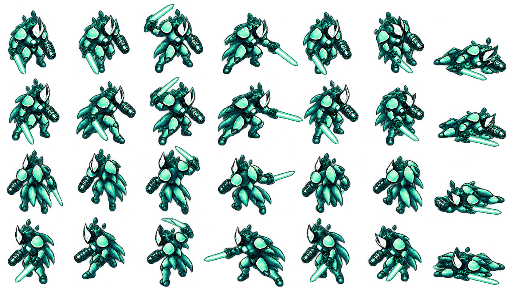
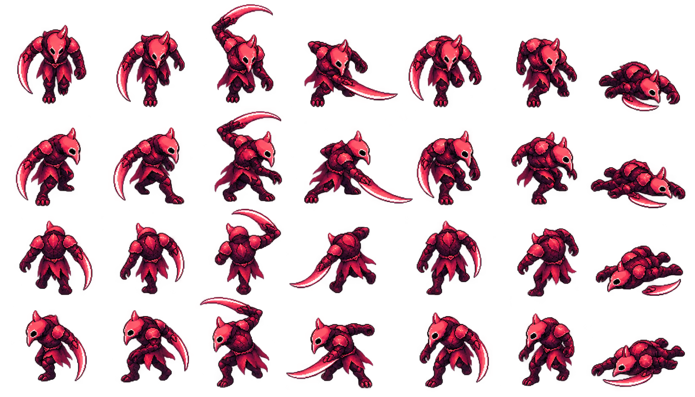
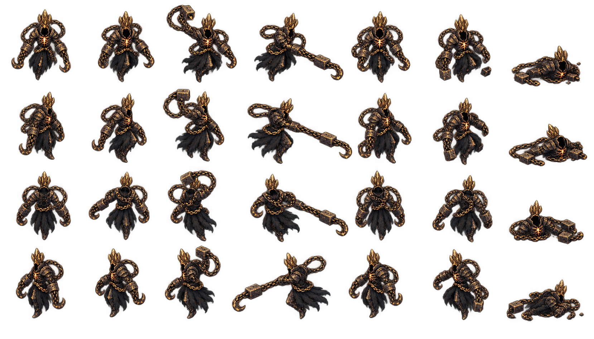
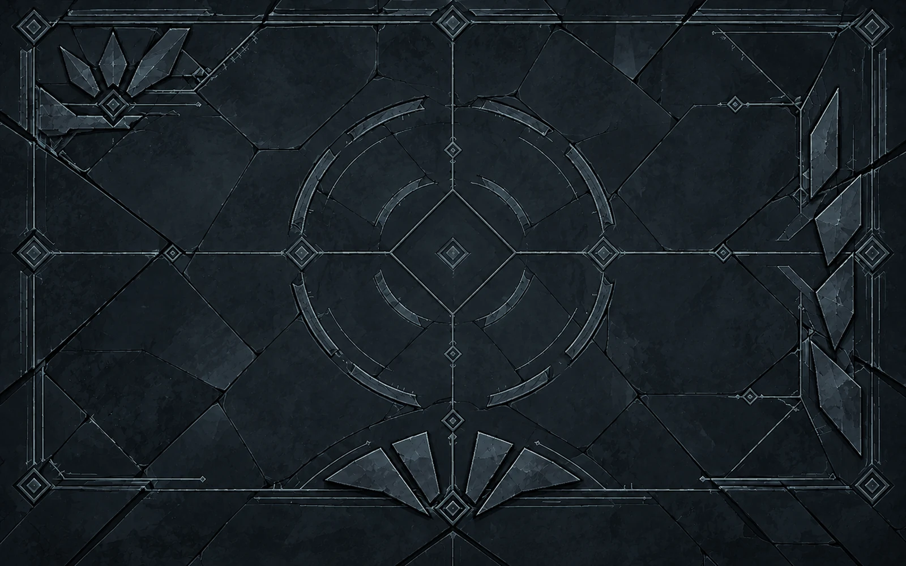
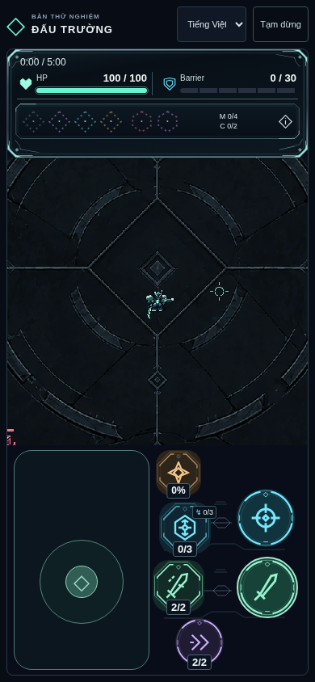
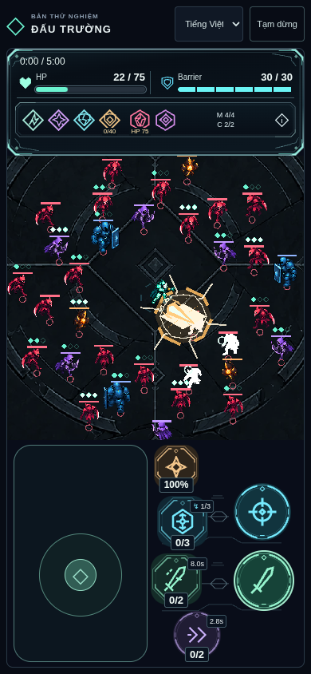
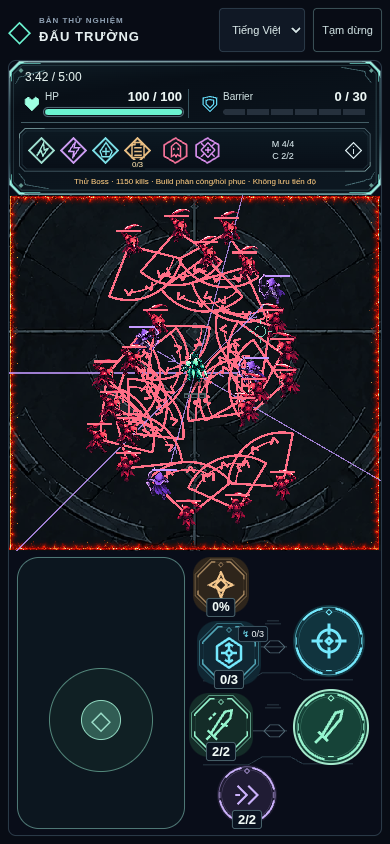
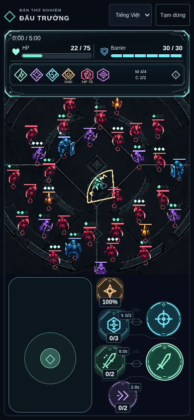

# Approved reference board / index

Audit2026-10-26, baseline main@bcd148b / Release v0.1.0. [Art Bible](../../ART_BIBLE.md) quy định cách dùng. Board này **nhúng ảnh có sẵn**, không generate/crop/đổi production assets. Ảnh runtime là screenshot renderer local/fixture ở milestone đã accepted, không tự gọi live hoặc natural run. Approval trích từ note repo, không có message permalink gốc.

## Player

- Asset runtime chung: [atlas PNG](../../public/assets/actors/occult-actors.png), [frame metadata](../../public/assets/actors/occult-actors.json); keys `player/<facing>/<pose>`.
- [Actions source](../q7c/source/player-actions-production-v1.png), [exact prompts](../q7c/source/PROMPTS.md), [hash/registration/processing/quyền](../q7c/runtime-assets.json).
- Approval: “visual approved q7c” rồi “duyệt q7c đạt”,2026-10-26, code0041064/deploy2ef6d48: [evidence](../q7c/IMPLEMENTATION.md). ImageGen source riêng, không crop board; model/seed không cung cấp, output terms dịch vụ, không gán CC0/độc quyền.

## Enemy

- Đúng role: [Archer](../q7c/source/archer-production-v1.png), [Volatile](../q7c/source/volatile-production-v1.png), [Bulwark](../q7c/source/bulwark-production-v1.png). Mở ảnh role tương ứng trước khi generate; Grunt không thay ref cho mọi enemy.
- Runtime [atlas](../../public/assets/actors/occult-actors.png) + [metadata](../../public/assets/actors/occult-actors.json); keys `grunt/archer/volatile/bulwark/<facing>/<pose>`. [Prompts](../q7c/source/PROMPTS.md), [provenance/hashes](../q7c/runtime-assets.json), [approval cùng Q7C](../q7c/IMPLEMENTATION.md). Rights như Player, không palette swap identity.

## Boss

- [Patterns source](../q7c/source/boss-patterns-production-v1.png), [prompts](../q7c/source/PROMPTS.md), [hashes/atlas processing](../q7c/runtime-assets.json). [Runtime sweep](../q7c/runtime/after-boss-0-390.png), [ring](../q7c/runtime/after-boss-1-390.png), [slam](../q7c/runtime/after-boss-2-390.png). Runtime keys `boss/<facing>/<pose>` trong atlas chung, approved Q7C.
- Q8C Enraged accepted bổ sung: [raw source](../q8c/source/enraged-v1.png), [runtime PNG](../../public/assets/actors/enraged-transform.png), [exact prompt/giới hạn view](../q8c/source/PROMPTS.md), [hash/packer](../q8c/source/asset.json), [runtime1.4s freeze390](../q8c/evidence/enrage-freeze-390.png). ImageGen từ Chain Warden accepted; chỉ view front dùng trong transform, không coi mọi view raw sheet accepted đủ direction.
- Manifest Enraged còn ghi awaiting là snapshot cũ; approval Q8C bên dưới mới là trạng thái hiện hành. Approval Q8C “q8c đạt”,2026-10-26,8cbff77/7625fa2: [README](../q8c/README.md). Không dùng ảnh transform0.8s cũ làm timing chuẩn.

## Environment

- [Original source](../q7a/artwork/arena-floor-source-v2.png), [exact prompts](../q7a/PROMPTS.md), [provenance/source→runtime hashes/rights/tint](../q7a/runtime-asset.json).
- ImageGen source từ concept V2 đã được user cho triển khai; Pillow Lanczos1600×1000/WebP88; tint runtime#7A8791. Không lấy raw brightness thay screenshot đã tint.
- Approval floor-only “hiện 7a chỉ mới có thay đổi về sàn arena? nếu vậy thì t approved”,2026-10-26,0e0a9af/2e48166: [evidence](../q7a/IMPLEMENTATION.md).

## UI

- Original project SVG: [hud-frame](../../public/assets/ui/hud-frame.svg), [hud-inset](../../public/assets/ui/hud-inset.svg), [glyphs](../../public/assets/ui/hud-icons.svg), [basic ring](../../public/assets/ui/control-ring.svg), [power octagon](../../public/assets/ui/control-power.svg), [pair bridge](../../public/assets/ui/attack-pair.svg).
- [Runtime provenance/hashes](../q7b/runtime-assets.json), [current layout/approval](../q7b/HUD_V3.md), [historical study prompts](../q7b/PROMPTS.md). SVG hand-authored trong repo, không extract pixels từ ảnh user/third party; không có prompt ImageGen cho từng SVG, không bịa.
- Approval “q7b đã đạt”,2026-10-26,5ee970e/78f07e6. Ảnh opening có actor trước Q7C, chỉ dùng chuẩn HUD; actor chuẩn lấy Q7C. Concept HUD mobileV1/V2 và DOM layout-preview chưa icon-only không làm baseline hiện hành. Bản ảnh HUD user gửi chat không được lưu độc lập trong repo.

## VFX

- Approved dynamic VFX preserved trong Q7C: [charged renderer](../../src/game/chargedVfx.ts), [telegraph/Rupture](../../src/game/EnemyVisual.ts), [Barrier](../../src/game/BarrierVisual.ts), [synergy/relay](../../src/game/BuildVisual.ts). Đây là code/dynamic shapes, **không có standalone ImageGen texture/prompt** cho mỗi effect. Screenshot là reference, không crop làm production asset.
- [Grayscale same runtime](../q7c/runtime/after-grayscale-390.png), [approval/fixture limits](../q7c/IMPLEMENTATION.md).

- Arrival production: [source PNG](../q8c/arrival-runtime/source/arrival-edge-production-v1.png), [runtime strip](../../public/assets/arena/arrival-edge.png), [exact ImageGen prompt](../q8c/arrival-runtime/source/PROMPT.md), [hashes/processing/rights](../q8c/arrival-runtime/source/asset.json), [runtime rendering/approval](../q8c/arrival-runtime/README.md).
- ConceptV2/audio sketch “ok, làm đi” trước tích hợp; runtime Q8C “q8c đạt” trên8cbff77/7625fa2. Generated riêng từ project concept accepted; không crop concept board. Source→512×32alpha strip,4TileSprites, halo10/14px dưới body/cue. Stale “awaits playtest” trong manifest là snapshot trước approval mới, không phải blocker hiện hành. Không suy ra màu HEX texture đã có swatch riêng.

## Runtime composition / mobile / crowd / grayscale

| Tình huống | Reference renderer thật | Cách dùng / giới hạn |
| --- | --- | --- |
| Mobile crowd | [320](../q7c/runtime/after-crowd-320.png), [390](../q7c/runtime/after-crowd-390.png) |33enemy fixture, same family actor/floor/HUD; không natural encounter |
| Landscape / desktop | [844](../q7c/runtime/after-crowd-844.png), [1440](../q7c/runtime/after-crowd-1440.png) | Cùng cảnh so scale/readability |
| Grayscale | [390](../q7c/runtime/after-grayscale-390.png), [1440](../q7c/runtime/after-grayscale-1440.png) | Grayscale renderer cùng fixture; không generated grayscale minh họa |
| Player4góc | [NW](../q7c/runtime/corner-nw-390.png), [NE](../q7c/runtime/corner-ne-390.png), [SW](../q7c/runtime/corner-sw-390.png), [SE](../q7c/runtime/corner-se-390.png) | Kiểm HUD/camera/floor motifs không che Player |
| Q8A density | [390](../q8a/evidence/crowd-390.png), [1440](../q8a/evidence/crowd-1440.png) |48enemy visual fixture, [approval/limits](../q8a/README.md); không deviceFPS |
| Q8C Arrival | [320](../q8c/arrival-runtime/evidence/peak-320.png), [844](../q8c/arrival-runtime/evidence/peak-844.png), [1440](../q8c/arrival-runtime/evidence/peak-1440.png) |24enemy/cue stress fixture, xem [report](../q8c/arrival-runtime/evidence/browser.json) |
| Q8C transform/follow-up | [freeze1440](../q8c/evidence/enrage-freeze-1440.png), [follow-up390](../q8c/evidence/followup-390.png) | Follow-up là snapshot renderer, không motion/device proof |
| Result presentation Q7D | [Victory](../q7d/evidence/mobile-victory.png), [Defeat](../q7d/evidence/mobile-defeat.png) | [Accepted polish, không artwork mới](../q7d/README.md) |

## Không dùng làm chuẩn / còn thiếu

- Q7A conceptV1/masonry và mockup có HUD/actors sai; contrast-palette-v1 chỉ nguồn semantic hierarchy đã khóa, không là approval các nhân vật trong board.
- Q7C concept sheets/research là lịch sử; source production + renderer accepted mới là baseline. Không dùng atlas-inspection labels làm specification mới; frame keys/metadata gốc là nguồn mapping.
- Q8C Arrival boardV1 đã superseded; warning Graphics cũ và transform0.8s không hiện hành. Không nhập lịch sử này vào DDR.
- Không có6category nào trống. Thiếu bằng chứng bổ sung: message permalink gốc, model/seed ImageGen, raw HUD reference từ chat, standalone approved sheets cho mọi dynamic VFX, full Enraged4direction mới, exact lighting angles/Arrival HEX swatches; device/Safari/iOS/thermal coverage chưa đủ. Chỉ báo blocker khi task mới phụ thuộc phần thiếu, không tự generate/bịa approval để lấp index.
- Quyền dùng generated output theo điều khoản dịch vụ áp dụng; không khẳng định CC0/độc quyền. Reference repo và original SVG giữ provenance có sẵn. Muốn thêm external art phải xác minh quyền trước.

## Q9C Anomaly VFX — accepted V1.1

User “visual ok, làm đi” ngày2026-10-27 duyệt [boardV1.1](../q9c/vfx-art-v1/source/concept-v1.1.png), common source signature và6motif; [proposal/provenance](../q9c/vfx-art-v1/README.md). Đây là approved visual target theo Art Bible hiện hành, không đổi direction/palette hoặc nhập DDR. [Production source/runtime evidence](../q9c/vfx-production/README.md) đã **ACCEPTED — USER PLAYTEST APPROVAL** qua user “đạt r” ngày2026-10-27 trên59b9a61 (bàn giao3268f15), Pages40509711771 SUCCESS; nguồn hội thoại hiện tại không permalink. Đây là reference runtime Anomaly hiện hành; giữ approval Q7C/Q8C, Art Bible/direction và giới hạn coverage đã ghi. Manifest assets.json là snapshot visual approval trước playtest, không là gate còn chờ. Không Q9D.

## Q9D Ascension VFX — accepted V1.1

User “duyệt, làm đi” ngày2026-10-28, hội thoại task hiện tại không permalink, duyệt [board/mockupsV1.1](../q9d/vfx-art-v1/README.md) và giao production/integration. [Production/source/hash/renderer/checklist](../q9d/vfx-production/README.md). Motif ripple/scar, Huntereye, localFracturefork+penaltyticks, Wardenchaincrown; giữArtBible/direction/geometry/balance. Q9D gồm VFX V1.1 đã **ACCEPTED — USER PLAYTEST APPROVAL** qua user “duyệt 9d” ngày2026-10-28 trênffd39a9/bàn giaoa985145, Pages40629442727 SUCCESS; nguồn hội thoại hiện tại không permalink. Giữ giới hạn coverage kỹ thuật; không DDR Approved hoặc Q9E. Các manifest/ảnh concept giữ trạng thái lịch sử trước playtest, không là gate còn chờ.
