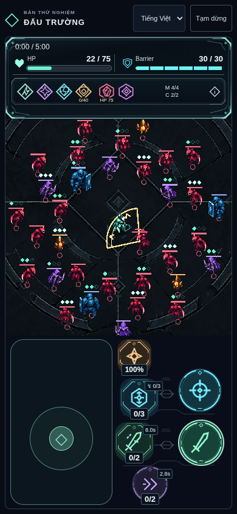
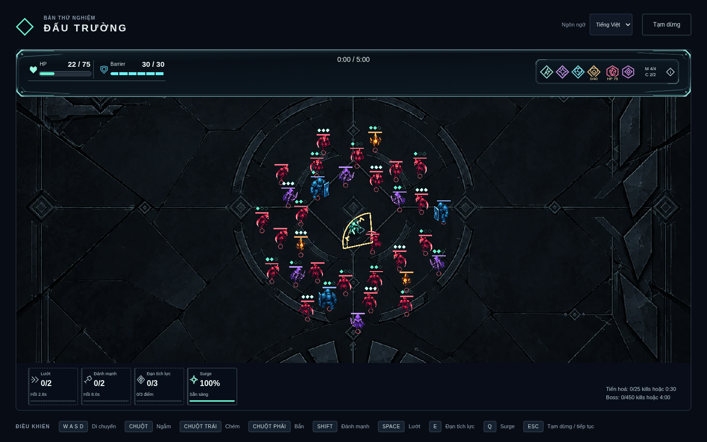
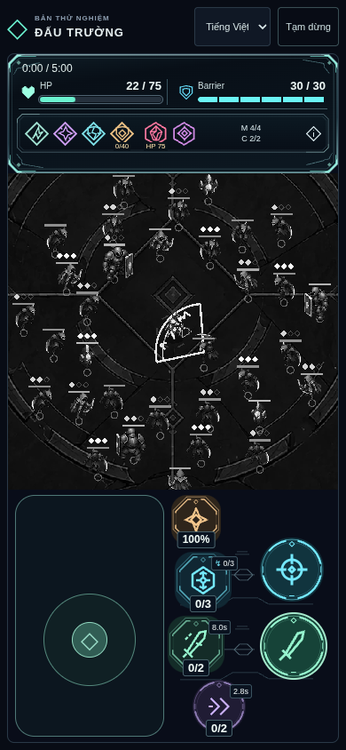

# Dungeon/Skill Rework — 12 câu review, đề xuất V1

> **Trạng thái hiện hành (2026-11-14):12/12 mục đã được user duyệt thiết kế qua “all y”; R12 bổ sung workflow planning→spec lock.** Nội dung bên dưới giữ bản chụp đề xuất V1 tại cc6f54c, các nhãn Proposed/0-duyệt là trạng thái lúc soạn. Xem C09 trong [log](DESIGN_CHECKLIST.md) và [workflow](planning/WORKFLOW.md). Chưa khóa detailed specs, chưa artwork approval hoặc quyền implementation.

Task **DUNGEON-REVIEW-01 · Revision1 · 2026-11-14 · PROPOSED — CHỜ USER REVIEW**.

**Đã chuẩn bị12/12 mục; chưa có mục nào được user duyệt.** Mỗi mục là một bảng/đề xuất trọn gói, không tách thành quiz từng số. Phản hồi mẫu: `R01 đồng ý`, `R02 sửa ...`, `R03 để sau`. Có thể review từng mục; duyệt tài liệu không tự mở implementation hoặc duyệt artwork chưa tồn tại.

Nguồn đã chốt: [log Q01–Q61/C01–C07](DESIGN_CHECKLIST.md). [Queue](REVIEW_QUEUE.md) · [task card](../combat-v2/tasks/DUNGEON-REVIEW-01.md). Tất cả thông số/catalog mới bên dưới là **baseline đề xuất để thử**, không là balance nghiệm thu. Không sửa production/main; không có code/art mới trong lượt này.

| Review | Nội dung |
| --- | --- |
| [R01](#r01) |8active/timing/input phụ lục |
| [R02](#r02) |9support/compatibility/tradeoff/proc caps |
| [R03](#r03) |Phân giải/nâng ô/economy trong lượt |
| [R04](#r04) |Giá unlock/điểm meta/Ascension |
| [R05](#r05) |Catalog modifier/range/cap/tổ hợp |
| [R06](#r06) |Atlas reference/layout/density/camera |
| [R07](#r07) |Roster/rarity/affix/AI |
| [R08](#r08) |4Boss/moves/pha/nhịp |
| [R09](#r09) |Power curve/HP-damage/công thức |
| [R10](#r10) |UI-state/save/tutorial/audio/legacy mapping |
| [R11](#r11) |Audit artwork/reference/phạm vi làm mới |
| [R12](#r12) |Milestone/technical-visual-playtest acceptance |

## Phần đã chốt được giữ

Tree9nấc, đường nối riêng/xem toàn cây/chọn1node mỗi nấc; camera follow/world liền mạch. Main auto+bật-tắt/override,2phụ manual,Dash+bình riêng;4main/4phụ/9support/3-2-2; không mana. Level1–5theo ô, túi build/temp material qua node/reset cuối lượt. Hai draft ở node1–8, một draft trong node9; final chỉ thưởng hoàn thành. Bank meta sau Boss/giữ100%; save node dở về entry/reward pending không nhận trùng. Không cosmetic/migration.

Modifier random1..cap: nấc1–2cap1/3–4cap2/5–6cap3/7–9cap4; nhận khi vào node/giữ tới final/cộng tới cap. Q35 số1buff+1debuff đã đượcQ56 thay. Density phải theo cảm giác Atlas; quota12–24bầy cũ chưa duyệt. Bình đã chốt100charge/cost40/35%ngay+20%trong4s/refresh không stack/reuse0,5s;white4-blue8-amber20charge;adds3đợt5white tại75/50/25%Boss;start/sauBoss đầyHP-charge. Các mục dưới chỉ định lượng/thích nghi tiếp, không hỏi lại các rule này.

## R01

**Câu review: Tám active có hiệu lực, tầm đánh và timing cụ thể như bảng này có phù hợp không?**

**Recommend:** một hành vi rõ cho mỗi skill; main chuyên clear khác nhau, phụ tạo quyết định burst/kiểm soát/phòng thủ/đặt trụ. Giữ Q14–Q23/Q36/Q38–Q39/Q60. Các tên/tag/thông số mới là proposal.

### Đơn vị và phạm vi

`D=32 world px`, bằng đường kính collider Player baseline16px; giây là simulation time, bước1/60s. Đây là đơn vị world, không CSSpx. HP Player100 và speed260px/s lấy baseline `src/game/combat.ts`/`movement.ts`; không suy sprite body=collider. Đề xuất bản đầu dùng damage scalar với tag hành vi (projectile/area/channel/duration), chưa mở hệ crit/kháng/nguyên tố/armor mới. Tên/màu năng lượng không tự tạo elemental proc. Phần thu hẹp damage này cần review tại R01/R10, chưa là quyết định đã chốt.

| ID · tên VI / EN | Hành vi và tag | Lv1 / phạm vi | Nhịp / windup→commit / recovery |
| --- | --- | --- | --- |
| A1 · Liềm quét / Crescent Sweep | Cone melee,hit,area; trúng mọi địch trong cone/tường chặn |80damage;150°;3,2D | Cadence0,55s;commit0,10s;recovery hình0,12s |
| A2 · Đạn xuyên / Needle Shot | Projectile,hit; đi thẳng,xuyên sẵn1địch; không explosion nền |75damage;range7D;speed12D/s | Cadence0,40s;commit0,05s;recovery0,08s |
| A3 · Sóng xung / Pulse Nova | Area,hit; tâm luôn ở Player |60damage;radius3,2D | Cadence0,80s;commit0,08s;recovery0,10s |
| A4 · Tia hội tụ / Focus Beam | Channel,line-area,hit; tia dừng ở tường, trúng các địch dọc tia |16damage/tick0,10s;length6,5D;width0,7D | Khởi channel0,12s;tick theo clock thật;di chuyển70%speed khi channel |
| A5 · Chấn nổ / Impact Burst | Manual,target-point,area,hit |240damage;radius3D;cast range6D | CD7s;commit0,25s;recovery0,20s |
| A6 · Vùng trì hãm / Suppression Field | Manual,target-point,area,duration; không root/stun |8damage/0,5s;slow35%;radius3,5D;duration4s;range5D | CD10s;commit0,20s;recovery0,15s |
| A7 · Giáp hộ thân / Ward | Manual,self,duration; shield thay thế,không cộng lớp | Shield30%maxHP;duration3s | CD12s;commit ngay khi nhấn hợp lệ;recovery0 |
| A8 · Trụ xuyên kích / Needle Totem | Manual,target-point,turret,duration; trụ bắn projectile áp dụng support đã gắn |35damage/viên;cadence0,50s;duration5s;place5D;target7D | CD12s;commit0,25s;recovery0,15s;max1trụ sống |

Mains không có CD kỹ năng riêng. Windup/recovery không khóa di chuyển của A1/A2/A3/A5/A6/A8; nhịp main không được reset do đổi aim/bật-tắt/đóng bảng. Channel bắt đầu lại không tạo tick miễn phí. Phụ/Dash ngắt main theo Q39; main không ngắt thao tác manual.

**Commit/cancel:** CD phụ bắt đầu lúc effect thực sự phát ở commit. Hủy trước commit: không effect/không CD; sau commit: CD giữ, effect đã phát tiếp tục. Dash hủy phần chưa phát (kể cả echo chưa tới lượt), không hoàn tài nguyên. Potion dùng tức thì khi hợp lệ, không hủy Dash hoặc cast phụ; một nhấn một lần/reuse0,5s. Priority đề xuất nếu cùng tick: death/pause→Dash→phụ→main; potion độc lập nhưng chỉ khi còn sống. Cooldown-input buffer chỉ0,12s ở lúc hết action lock, không queue suốt một CD dài.

**Aim:** Q38 nearest hợp lệ/sticky/manual override giữ nguyên. Ground cast dùng điểm người chơi đang ngắm; nếu điểm ngoài range thì preview clamp về biên hợp lệ, nếu tường cản thì báo invalid/không tiêu CD. Ward luôn self; nova không dời tâm. Không chọn vùng tối ưu thay người chơi. Tất cả target cast tối đa7D, xem camera R06.

**Phụ lục input — Proposed, không phục hồi câu Q61:** desktop WASD/LMBmain,Q-Ephụ,SpaceDash,Fbình; touch joystick/vùng main/2phụ/Dash/bình. Phụ hướng-điểm tap theo aim hiện có, giữ-ngắm/thả cast; khiên nhấn dùng ngay. RMB/Esc hoặc vùng cancel touch hủy aim trước cast; pointercancel/blur/pause hủy thay vì cast giả. Chỉ dùng mapping này nếu R01 được duyệt; bố cục cần mockup R11. Không hỏi lại role auto/manual đã chốt.

## R02

**Câu review: Ma trận và tradeoff của chín support dưới đây có phù hợp không?**

**Recommend:** support chỉ thay phần thật sự tồn tại; mọi tradeoff hiển thị trước khi gắn. Không mana, không level support, giữ Q19–Q25/Q37/Q57.

| ID · support | Tác động | Đánh đổi |
| --- | --- | --- |
| P1 Đa đạn |+2projectile/volley,fan±12° |−40%damage; một target chỉ nhận một projectile trong cùng volley-family |
| P2 Xuyên |+2lần xuyên |−10%damage |
| P3 Chain |+2hop,range4D/LOS,không quay lại target đã hit |−25%damage |
| P4 Mở rộng |+25%radius; beam tăng width,không length |−15%damage; riêng A6slow−5điểm% |
| P5 Lặp |1echo sau0,18s,40%damage của hit gốc | Main attack-speed−20điểm%; A5CD-duration+20% |
| P6 Kéo dài |+50%duration của field/shield/trụ | CD-duration+15% |
| P7 Tăng nhịp |+25%attack/cast rate, kể cả tick beam/shot trụ |−10%damage; không giảm CD phụ |
| P8 Hồi chiêu |CD-duration−25% ở phụ |−10%damage/shield; riêng A6slow−5điểm% |
| P9 Cường hóa |+35%damage; A7shield+25%;A6slow+15điểm% | Main rate−15điểm%; phụ CD-duration+20% |

`✓` là gắn được; `—` không có phần hành vi tương ứng. Với A8, các support projectile/rate tác động lên đạn trụ, không nhân số trụ hoặc auto đặt.

| Support | A1 | A2 | A3 | A4 | A5 | A6 | A7 | A8 |
| --- | --- | --- | --- | --- | --- | --- | --- | --- |
| P1 Đa đạn | — | ✓ | — | — | — | — | — | ✓ |
| P2 Xuyên | — | ✓ | — | — | — | — | — | ✓ |
| P3 Chain | — | ✓ | — | — | — | — | — | ✓ |
| P4 Mở rộng | ✓ | — | ✓ | ✓ | ✓ | ✓ | — | — |
| P5 Lặp | ✓ | ✓ | ✓ | — | ✓ | — | — | — |
| P6 Kéo dài | — | — | — | — | — | ✓ | ✓ | ✓ |
| P7 Tăng nhịp | ✓ | ✓ | ✓ | ✓ | — | — | — | ✓ |
| P8 Hồi chiêu | — | — | — | — | ✓ | ✓ | ✓ | ✓ |
| P9 Cường hóa | ✓ | ✓ | ✓ | ✓ | ✓ | ✓ | ✓ | ✓ |

**Thứ tự/giới hạn:** tạo volley→hit→xuyên trước→hết xuyên mới chain; tường kết thúc projectile. Cùng projectile không hit lại một target, cùng volley-family không shotgun bằng nhiều đường chain. Echo dùng family mới, chỉ echo một lần, không sinh echo từ echo; không sinh chain/spawn vòng lặp đệ quy. Chain tối đa3hop/projectile; xuyên tổng tối đa5địch sau target đầu; tổng projectile/volley tối đa5. Kills có owner duy nhất để không nạp charge nhiều lần.

| Tổng hiệu ứng sau support+node+level | Cap đề xuất |
| --- | --- |
| Damage modifier chung trước hệ số hit/echo | multiplier0,25–3,00; level multiplier tính riêng R03 |
| Attack/cast rate |−30%..+75%;interval=base/(1+rate) |
| Radius/beam width | tối đa+60%;beam length chỉ range modifier |
| CD-duration | tối thiểu50%base; không tạo CD cho main |
| Duration | tối đa+60%base;field≤8s,shield≤6s,trụ≤8s |
| Shield | tổng capacity≤60%maxHP; replace/refresh,không cộng lớp |
| Slow | quái thường≤60%;Boss≤20%,không kéo dài windup; không root/stun |
| Field/trụ đang sống | mỗi loại1; đặt lại thay bản cũ |

Phần trăm cùng stat cộng trong cùng bucket; penalty cũng cộng dấu âm/dương rõ, không nhân lũy thừa theo node. Slow tính theo điểm phần trăm: base theo cấp ô +P9(15điểm) −P4(5điểm) −P8(5điểm), rồi áp cap; Boss nhận35% strength đó, cap20%. Shield tính base capacity theo cấp ô ×(1+bonus shield), rồi cap60%maxHP. Echo40% là hệ số hit phụ được ghi riêng. Ví dụ A2Lv1+Đa đạn+Chain+Tăng nhịp, chưa node buff: damage/viên=`75×(1−0,40−0,25−0,10)=18,75`; ba viên tạo độ phủ nhưng không shotgun một Boss. Build đổi lại single-target, có thể bù bằng lựa chọn node/nâng cấp.

Tham khảo **ý tưởng hỗ trợ projectile và tradeoff** từ [PoEDB Chain Support](https://poedb.tw/us/Chain_Support) và [Multiple Projectiles Support](https://poedb.tw/us/Multiple_Projectiles_Support). Các số/ma trận/cap ở đây là thiết kế riêng, không chép mana multiplier hoặc tuyên bố tương đương PoE.

## R03

**Câu review: Economy nguyên liệu trong lượt với bảng chi phí này có phù hợp không?**

**Recommend:** một loại nguyên liệu tạm — tên đề xuất **Mảnh kỹ năng / Skill Shard**. Phân giải một support được2mảnh; không phân giải active, không drop thêm currency nâng cấp từ white/Boss ngoài nguồn đã chốt. Nâng theo ô Q36, đổi skill giữ cấp; số material/cost mới là proposal.

| Từ cấp→cấp | Giá mảnh | Tổng từLv1 | Damage multiplier cho A1–A5/A8 |
| --- | --- | --- | --- |
|1→2 |2 |2 |1,20 |
|2→3 |4 |6 |1,45 |
|3→4 |6 |12 |1,70 |
|4→5 |8 |20 |2,00 |

Lv1damage multiplier1. A1–A5/A8 tăng damage; A6 tăng slow35/40/45/50/55% qua Lv1–5 (damage tick vẫn8), Boss hưởng35%slow strength rồi chịu cap20%; A7shield30/35/40/45/50%maxHP. Level không tự giảm CD/tăng range/duration; các trục đó do support/node. Nâng ôLv1trống không cho phép: phải có active, cấp ô vẫn giữ khi thay.

**Kiểm ngân sách:**8node đầu×2draft +1draft trong node9 =17lựa chọn tối đa trước final. Starter có1support. Nếu1draft lấy phụ thứ hai và16draft lấy support thì sở hữu17support; gắn7còn10bản dư→20mảnh. Đủ max một ô, hoặc ba ôLv3 tốn18mảnh; **không hứa max cả ba ô**, vốn cần60mảnh. Chọn thêm active/giữ support dự phòng làm đổi ngân sách này.

**Offer rule đề xuất:** tối đa3offer khác nhau; ưu tiên2support và1active chưa sở hữu khi pool cho phép. Support có ít nhất một active tương thích trong túi hiện tại; một offer hướng mở build vẫn có thể là active khác. Boss đầu có lựa chọn phụ để lấp ô2 theo Q30. Khi hết active mới, roll support hợp lệ; không auto-salvage hoặc tạo offer trùng giả. Đổi/nâng/phân giải chỉ cửa sổ Q36, nghỉ node dở rollback entry.

## R04

**Câu review: Giá unlock và bảng điểm lâu dài sau Boss như sau có phù hợp không?**

**Recommend:** unlock là mục tiêu vài hành trình, còn trong lượt dựa draft. Catalog mở sẵn giữ Q40: A1/A2/A5/A7 vàP4/P7/P8/P9. Một lần mở thêm mục vào pool **hành trình sau**, không grant bản dùng miễn phí trong lượt hiện tại.

| Mục còn khóa | Giá điểm meta |
| --- | --- |
| A3 Nova |45 |
| A4 Beam |60 |
| A6 Field |35 |
| A8 Totem |45 |
| P1 Đa đạn |45 |
| P2 Xuyên |25 |
| P3 Chain |45 |
| P5 Lặp |40 |
| P6 Kéo dài |25 |
| **Tổng9unlock** | **365** |

| Nấc |1 |2 |3 |4 |5 |6 |7 |8 |9 | Bonus thắng toàn tree |
| --- | --- | --- | --- | --- | --- | --- | --- | --- | --- | --- |
| Điểm A0 |3 |4 |5 |6 |8 |10 |12 |15 |20 |25 |

| Ascension |0 |1 |2 |3 |4 |
| --- | --- | --- | --- | --- | --- |
| Điểm multiplier |1,00 |1,15 |1,30 |1,45 |1,60 |
| Full-clear tổng điểm,ceil từng khoản |108 |128 |144 |161 |175 |

Mỗi khoản chốt một lần ngay sau Boss; chết/dừng giữ100% Q41. Không điểm cho phần map dở hoặc adds. A0full-clear3lần được324, lần4đủ365 nếu chưa có điểm trước: đây là phép tính, **không dự báo người chơi sẽ thắng bốn lượt liên tục**. Mốc partial tới node5 được26điểm, đủ unlock rẻ25. Không cân bằng theo đồng hồ/tốc độ clear.

Mua unlock ở menu/result giữa các hành trình; trong expedition dùng snapshot catalog lúc khởi đầu. Khi đủ catalog: hiển thị hoàn thành, điểm dư tiếp tục được lưu theo banking, mục tiêu còn Ascension; không tự thêm cosmetic/sink mới. Đây là cách xử lý điểm dư được đề xuất trong R04, chưa là quyết định cũ của Q42.

## R05

**Câu review: Pool modifier, khoảng roll và cap dưới đây đã tạo được lựa chọn đường đi thú vị mà vẫn có cách đối phó chưa?**

**Recommend:** dùng 10 buff và 12 debuff ở bản đầu. Giữ count random `1..cap` theo chặng đã chốt; không bắt buộc một buff đi cùng một debuff. Preview cả giá trị riêng của node và tổng sau khi chọn node đó.

Các khoảng dưới là roll ở chặng cuối. Với chỉ số liên tục, nhân độ mạnh roll với `0,35 / 0,55 / 0,80 / 1,00` tương ứng nấc `1–2 / 3–4 / 5–6 / 7–9`, làm tròn hiển thị đến một chữ số thập phân. Giá trị đã nhận giữ nguyên, không tự mạnh lên ở nấc sau. Mod đếm nguyên có nấc mở riêng. Cap là **tổng từ node trong cả hành trình**; cap phối hợp support ở R02/R09 vẫn áp dụng.

| ID · buff | Roll chặng cuối | Cap từ node / phạm vi |
| --- | --- | --- |
| B01 · Sức công phá | +5–15% damage | +120%; mọi damage từ skill Player/trụ |
| B02 · Nhịp tấn công | +4–10% attack rate | +40%; main và nhịp bắn trụ, không giảm CD phụ |
| B03 · Lan rộng | +4–10% radius/beam width | +30%; đúng tag area, không tăng beam length |
| B04 · Hồi chiêu | −3–8 điểm % CD duration | −25%; chỉ hai ô phụ |
| B05 · Sinh lực | +5–12% maxHP | +60%; shield tính theo maxHP mới |
| B06 · Bước chân | +3–7% move speed | +20%; đi bộ, không tăng tốc/quãng Dash |
| B07 · Dược lực | +4–10% lượng hồi của bình | +25%; cả phần ngay và HoT |
| B08 · Tích bình | +8–16% charge nhận từ kill | +50%; không đổi max100/cost40 |
| B09 · Phân đạn | +1 projectile | Nấc5+; cap +2, tổng mỗi volley tối đa5; chỉ A2/A8 |
| B10 · Dư âm | +6–15% skill duration | +30%; A6/A7/A8 |

| ID · debuff | Roll chặng cuối | Cap từ node / phạm vi |
| --- | --- | --- |
| D01 · Quái bền bỉ | +8–18% monster HP | +75%; có Boss, không đổi số pha |
| D02 · Quái hung hãn | +5–12% monster damage | +40%; có Boss |
| D03 · Truy đuổi | +4–10% monster move speed | +25%; Boss chỉ hưởng tối đa +15%, không rút windup |
| D04 · Loạt đạn | +1 monster projectile | Nấc3+; cap +2, Boss tối đa +1; không nhân số vùng nổ |
| D05 · Vùng nguy hiểm | +4–10% monster area radius | +25%; Boss tối đa +15%, cue phải tăng đúng hình học |
| D06 · Bầy đông | +6–15% số hộ tống mỗi bầy | +35%; làm tròn một lần khi tạo node, không spawn bù trong trận |
| D07 · Thủ lĩnh xanh | +3–6 điểm % bầy blue | Nấc3+; cap +15 điểm %, trừ vào bầy white |
| D08 · Thủ lĩnh amber | +1–3 điểm % bầy amber | Nấc5+; cap +6 điểm %, trừ vào bầy white |
| D09 · Dược lực suy yếu | −5–12% lượng hồi bình | −30%; không khóa sử dụng bình |
| D10 · Tích bình chậm | −6–14% charge nhận từ kill | −35%; adds Boss vẫn cho charge |
| D11 · Hồi chiêu chậm | +4–10 điểm % CD duration | +25%; phụ, không ảnh hưởng main/Dash/bình |
| D12 · Đạn nhanh | +5–12% projectile speed của quái | +30%; giữ cue/windup |

**Cách roll đề xuất:** mỗi mod có xác suất chọn nhánh buff `75/65/55/50%` theo bốn chặng; sau đó chọn loại hợp lệ không trùng trong cùng node. Đây là xác suất, không quota buff/debuff. Ở nấc1, bảo đảm ít nhất một node có buff để người chơi mới có đường khởi đầu thuận lợi. Tree roll một lần từ đầu, có thể xem trước, không reroll bằng reload.

Khi tạo tree, loại mod chắc chắn có hiệu lực bằng0 trên mọi đường có thể tới node đó. Sau khi chọn đường, preview tính delta theo tổng thực tế: nếu đường này đã chạm cap thì ghi rõ +0, không reroll mod đã công khai. Không roll cả ba D04/D05/D12 trong cùng một node; nếu tổ hợp cộng dồn làm các đòn Boss mất khoảng né đã định ở R08 thì phải giới hạn giá trị roll, không thu nhỏ cue hoặc đổi luật theo thiết bị. Catalog không có reflect, khóa hồi máu, khóa main/Dash, mana, crit hay kháng chưa tồn tại.

Nguồn thích nghi: [PoEDB — Quantity](https://poedb.tw/us/Quantity) có nhóm tăng nguy hiểm của map; [Projectile](https://poedb.tw/Projectile) và [Area of effect](https://poedb.tw/us/Area_of_effect) cho các trục đạn/vùng. **Catalog, số và cap ở đây là thiết kế của game mình.** Buff sức mạnh Player là cách thích nghi cho tree hiện tại, không phải chép nguyên cơ chế reward map PoE hoặc mở thêm hệ loot.

## R06

**Câu review: Layout, mật độ bầy và camera đề xuất này có đúng hướng cảm giác clear Atlas mà m muốn không?**

**Recommend:** map dài, nhiều cụm quái liên tiếp; có khoảng chuyển nhịp ngắn và nhánh tùy chọn. Khởi đầu với một biome **Hầm Ấn Vỡ / Broken Seal Crypt**, ba biến thể kiến trúc trong cùng bộ art; random đường và phân bố bầy thay vì nhiều biome chưa đủ art.

**Trạng thái reference:** [Atlas of Worlds](https://www.pathofexile.com/atlasofworlds) là trang expansion lịch sử, dùng để tham chiếu cấu trúc map/Boss. [PoEDB — Maps](https://poedb.tw/us/Maps) phân biệt pack count, pack size và tỷ lệ magic/rare. Chưa có footage đại diện được xem và đếm theo một protocol ở lượt này; không có số bầy PoE đã đo. Các con số sau là **candidate cho game mình**, chưa chứng minh đạt cảm giác Atlas. Trước khóa mật độ runtime phải đối chiếu một đoạn gameplay mapping được chọn rõ và playtest cảnh thật; đây là bước kiểm R06, không thêm câu hỏi brainstorm.

| Hạng mục | Baseline đề xuất |
| --- | --- |
| Tổng bầy mỗi map | Nấc1–3:45–55; nấc4–6:50–60; nấc7–9:55–70 |
| Quy mô bầy | 8–18 hộ tống +1 thủ lĩnh; D06 điều chỉnh số hộ tống |
| Nhịp bố trí | Cụm2–3bầy trong pocket; khoảng chuyển3–6D giữa cụm dọc đường, không chia đều thành chuỗi bầy đơn |
| Route chính | Chiều dài đường đi khoảng140–220D; hành lang rộng4–8D, pocket rộng14–22D |
| Đường phụ | Nhánh ngắn/loop, chiếm tối đa20% tổng kill-weight; không ép vét nhánh |
| Điểm vào | Khoảng an toàn6D trước cụm đầu; không có hit trong lúc chuyển màn |
| Phòng Boss | Vùng chơi đường kính khoảng22D, cửa riêng và chỗ né rõ |
| Tải quan sát | Thường30–60 quái đang giao chiến trong vùng thấy; stress80–120, chưa đo FPS |

Đây không phải quota12–24 bầy trước đây đã không được duyệt. Với khoảng14 con/bầy, 45–70 bầy tương đương khoảng630–980 quái trong toàn map trước modifier; **toàn map khác số đang hoạt động/hiện cùng lúc**. Không xóa quái hoặc đổi luật để đạt tải.

| Nấc | Bầy thủ lĩnh white | Bầy thủ lĩnh blue | Bầy thủ lĩnh amber |
| --- | --- | --- | --- |
|1–3 |87% |10% |3% |
|4–6 |82% |14% |4% |
|7–9 |77% |18% |5% |

Đây là tỷ lệ candidate mới, không số PoE hay tỷ lệ cũ đã duyệt. Từ nấc3, khoảng12% bầy amber có hộ tống blue thay white; không cap cứng một bầy đặc biệt/map. Chốt số nguyên bằng phân bổ có tổng đúng pack count; Ascension/node điều chỉnh theo R05/R09.

**Hai thanh tiến độ riêng:** Boss mở ở khoảng75% kill-weight toàn map (`white1 / blue3 / amber8`). Draft giữa map dùng elite-weight: thủ lĩnh blue1/amber3, hộ tống blue0,1; threshold45% tổng elite-weight, tối đa một draft. Đường chính phải có ít nhất80% kill-weight và đủ elite-weight để nhận draft. Generation kiểm hai điều kiện này; không chữa layout lỗi bằng bắt vét đường phụ. Không có deadline hoặc thưởng tốc độ.

**Camera đề xuất:** trục ngắn của vùng world nhìn thấy tối thiểu16D; follow mềm khoảng0,08s, offset theo aim tối đa0,75D. Cast/auto-target giới hạn7D trên cả hai nền tảng; widescreen thấy thêm ở trục dài nhưng không tự nhắm xa hơn. Camera sát biên vẫn giữ Player trong vùng thao tác rõ, cho thấy backdrop tối ngoài world nếu cần. Minimap fog reveal, đánh dấu Boss khi khám phá theo contract. Camera scale/HUD mới còn cần mockup ở R11; chưa được visual approval chỉ vì có số.

## R07

**Câu review: Bốn vai trò quái, cấp thủ lĩnh và sáu affix dưới đây đã đủ đa dạng cho bản đầu chưa?**

**Recommend:** giữ nhận diện bốn họ quái hiện có, đổi vai trò/thông số theo dungeon. Leader tạo đe dọa khác nhau bằng affix; không chỉ tăng HP. Mọi số dưới là Lv1/nấc1/A0 trước rarity/modifier.

| Họ quái | HP / damage | Speed / windup / recovery / chu kỳ tối thiểu | Vai trò |
| --- | --- | --- | --- |
| Grunt |60 /5 |100px/s;0,42s;0,22s;0,85s | Áp sát, tầm1,8D; đánh có commit, không damage do chạm thân |
| Archer |45 /6 |90px/s;0,65s;0,35s;1,4s | Bắn thẳng, range7D/speed đạn7D/s, tường chặn |
| Volatile |45 /10 |110px/s;0,85s;recovery sống N/A | Tự nổ radius2D; bị giết trước commit thì hủy nổ |
| Bulwark |140 /9 |70px/s;0,75s;0,75s;1,6s | Cone2,8D; guard phía trước100° giảm50% damage, bỏ guard khi windup/recovery |

Chu kỳ tối thiểu tính từ commit trước đến commit sau; windup+recovery không được vượt chu kỳ. Guard là đặc tính Bulwark, không mở hệ armor chung. **Volatile không làm thủ lĩnh** ở bản đầu để tránh tự sát làm mất vai trò leader/affix; có thể làm hộ tống. White/blue/amber vẫn là ba cấp quái, Boss riêng. Hộ tống mỗi bầy chủ yếu Grunt, tối đa khoảng25% Archer/15% Volatile/10% Bulwark, còn lại Grunt; làm tròn giữ đúng tổng. Thành phần công khai khi khám phá, không đổi theo build hay thiết bị.

| Cấp / vị trí | HP multiplier | Damage multiplier | Collider radius đề xuất |
| --- | --- | --- | --- |
| Hộ tống white |1 |1 | Theo role/collider runtime cần audit khi implement |
| Thủ lĩnh white |3 |1,3 |20px |
| Thủ lĩnh blue |7 |1,6 |22px;1 affix |
| Thủ lĩnh amber |15 |2 |26px;2 affix tương thích |
| Hộ tống blue của bầy amber hiếm |2,5 |1,2 | Theo role; một passive chung cho cả bầy |

Passive hộ tống blue chọn tốc độ+15% hoặc guard giảm20% damage khi leader sống; không thêm một active hazard cho mỗi hộ tống. Leader chết tắt aura này, hộ tống còn sống tiếp tục chiến đấu.

| Affix leader | Hiệu lực đề xuất | Nhịp / giới hạn |
| --- | --- | --- |
| Nhanh nhẹn | Leader move speed+20% | Không rút windup/recovery |
| Hiệu triệu | Đồng minh trong5D move speed+15% | Tắt ngay khi leader chết; cùng aura không stack |
| Giáp hướng | Guard90° giảm35% damage | Bật2s/tắt3s; không chồng guard sẵn của Bulwark, lấy mức cao hơn |
| Gai bắn |4 đạn hướng quạt, mỗi viên50% damage cơ bản của leader | Cue0,8s;CD5s; một volley không shotgun cùng mục tiêu |
| Dấu ấn chậm nổ |3 điểm radius1D gần vùng Player đang đứng | Cue1s;damage mỗi dấu50% damage leader, mỗi dấu hit một lần;CD5s |
| Dây cản | Một lane rộng0,6D/dài4D gây slow20% trong1,5s | Cue0,8s;lane tồn tại1s;CD5s; không root/khóa Dash, không damage |

Ba affix cuối là active hazard: mỗi leader tối đa một loại. Amber lấy một active+một passive hoặc hai passive; không roll cùng tác dụng hai lần. Mỗi bầy leader chỉ đại diện một role, không đổi role ngẫu nhiên sau khi đã nhìn thấy.

**AI đề xuất:** phát hiện trong7D khi có line-of-sight hoặc bị đánh; chia sẻ aggro trong bầy, lan sang bầy khác ở phạm vi3D có đường thông. Tường chặn phát hiện, không gọi cả map. Đi xa18D khỏi home và không tương tác3s thì quay về bằng đường đi, giữ HP đã mất; không respawn/hoàn thưởng hoặc heal để farm. Một vùng giao tranh nhận tối đa6 melee/4 ranged/2 special attack windup đồng thời; quái khác vẫn di chuyển/bao vây. Chờ lượt **trước** windup, không cắt cue đã bắt đầu; chung luật mobile/desktop. Đây là budget readability mới cần thử cảnh đông, không dùng để cắt bớt pack khi tải cao.

Adds Boss:5 white Grunt/đợt, HP40/damage3 trước scaling, mỗi kill vẫn charge4; ba đợt đã chốt ở R08. Không có elite draft/material/meta từ adds.

## R08

**Câu review: Bộ đòn của ba Boss thường và final hai pha như sau có đủ khác nhau, có cửa né và phản công rõ không?**

**Recommend:** mỗi Boss thường ba đòn, phát rõ từng ý; final ghép lại thành combo có khoảng ngắt. Chain Warden dùng lại nhận diện, các tên/Boss/đòn mới vẫn là proposal cần artwork riêng. HP/scale ở R09. Các cue dưới là thời gian tối thiểu, không bị Ascension giảm.

| Boss / đòn | Hình học / damage cơ bản | Windup / active / recovery |
| --- | --- | --- |
| **Chain Warden — Càn quét** | Cone150°/4D;18 |0,70 /0,15 /0,60s |
| Nện xích | Circle radius2,5D;24 |0,90 /0,12 /0,70s |
| Phóng móc | Lane dài7D/rộng0,8D, đạn6D/s;14 |0,85 /bay theo range /0,70s |
| **Void Archer — Quạt tên** |5 đạn7D/s;8/viên, một volley chỉ hit Player một lần |0,80 /bay /0,60s |
| Ngắm đường |3 lane song song dài7D/rộng0,6D, khoảng trống giữa lane≥1,2D;22 |1,00 /0,12 /0,80s |
| Liên xạ |3 volley×3 đạn, cách0,25s;6/volley |0,90 /0,50 /0,70s |
| **Seal Binder — Tam ấn** |3 dấu radius1,7D, nổ cách0,3s;10/dấu, mỗi dấu hit một lần |0,85 /chuỗi0,60 /0,70s |
| Vành phong tỏa | Annulus bán kính trong3D/ngoài5D;20 |1,10 /0,20 /0,80s |
| Thập tự |2 lane vuông góc dài7D/rộng0,8D;18, giao điểm không double-hit |1,00 /0,15 /0,80s |

Boss thường xoay vòng ba đòn với khoảng nghỉ thêm0,4s sau recovery. Không lặp cùng Boss ở hai node kề nhau. Đứng yên trong windup; aim snapshot tại lúc bắt đầu windup, không bám Player đến sát commit. Với mod vùng/đạn, giữ lối né thật trên camera; không đủ lối thì hạn chế pattern/roll trước khi tạo node, không đổi giữa đòn.

**Final — Abyss Regent, HP14.000 ở A0 trước node mod:**

| Pha | Bộ đòn | Cửa phản công |
| --- | --- | --- |
|1, trên50%HP | Xuyên tuyến7D cue0,9s/damage24/recovery0,8s; quạt5đạn cue0,8s/damage8/volley/recovery0,7s; hai ấn radius2D cue1s/damage12/ấn/recovery0,8s | Thêm0,4s nghỉ giữa mỗi đòn; điểm ngắm khóa lúc cue bắt đầu |
|2, từ50%HP | Xuyên tuyến→quạt: sau recovery đòn đầu còn gap0,6s rồi cue mới0,8s; thay hai ấn bằng một nện radius3D cue1,1s/damage32/recovery1s | Không bỏ cue đòn sau; không thêm lần tăng tốc ngầm theo HP |

Đề xuất chuyển pha1,4s đóng băng simulation như hướng presentation Boss hiện tại: chỉ animation chuyển pha tiến, CD/HoT/quái không chạy; không phải một đoạn người chơi đứng chịu damage khi Boss bất tử. Đây là đề xuất áp dụng lại cho final mới, chưa được approval tự động từ Boss cũ.

**Adds giữ đúng75/50/25%:** mỗi mốc chỉ trigger một lần,5 white. Qua nhiều mốc trong một burst thì xếp hàng, sau đòn đang chạy/chuyển pha mới spawn; cue0,6s, điểm xuất hiện cách Player≥4D, cách hai wave ít nhất4s, tối đa5 adds còn sống. Nếu đủ5 thì wave sau chờ có chỗ, không ghi nhận đã spawn rồi mất wave. Không hồi thêm vô hạn; không invulnerability hoặc bắt giết adds mới được đánh Boss. Boss chết hủy wave chờ/clear adds và hazard, cleanup không cho charge/kill reward. Khi Player còn sống mới đi sang reward an toàn theo R10.

Phòng Boss khóa ra vào, ngoài phòng không bắn vào; không lui ra farm charge. Adds/đòn mới, transition và marker chưa có visual target; xem R11, không dùng bảng này làm artwork approval.

## R09

**Câu review: Power curve này có phù hợp làm baseline để nghiệm thu rồi cân bằng tiếp không?**

**Recommend:** tăng độ bền vừa phải theo nấc, sức ép chủ yếu đến từ bầy/affix/tổ hợp node. Giữ nguyên timing né trên mọi Ascension và thiết bị. Không thêm armor/crit/gear để chữa số damage.

Player baseline: HP100, collider radius16px, speed260px/s, simulation60Hz. Dash2charge, hồi một charge2,2s, duration/protection0,18s, speed920px/s; sau khi nhận damage có invulnerability0,65s theo combat hiện tại. **Không nhầm0,5s invulnerability của Surge cũ thành Dash.** Các giá trị này là fallback đề xuất giữ; action Surge cũ xử lý tại R10.

| Nấc |1 |2 |3 |4 |5 |6 |7 |8 |9 |
| --- | --- | --- | --- | --- | --- | --- | --- | --- | --- |
| HP quái thường multiplier |1 |1,08 |1,16 |1,26 |1,38 |1,52 |1,68 |1,88 |2,10 |
| Damage quái thường multiplier |1 |1,03 |1,06 |1,10 |1,15 |1,20 |1,25 |1,30 |1,35 |
| HP Boss thường, base2.400 |1 |1,25 |1,55 |1,90 |2,30 |2,75 |3,25 |3,80 |Final riêng |
| Damage Boss thường multiplier |1 |1,05 |1,10 |1,15 |1,20 |1,25 |1,30 |1,35 |Final riêng |

Final dùng profile14.000HP/damage tại R08, không nhân thêm hệ số nấc9 vào profile đó. Vẫn chịu Ascension và node mods.

| Ascension |0 |1 |2 |3 |4 |
| --- | --- | --- | --- | --- | --- |
| Monster/Boss HP |1 |1,12 |1,26 |1,42 |1,60 |
| Monster/Boss damage |1 |1,08 |1,18 |1,28 |1,40 |
| Bầy blue thêm, điểm % |0 |2 |4 |6 |8 |
| Bầy amber thêm, điểm % |0 |0,5 |1 |1,5 |2 |

Tỷ lệ thêm trừ khỏi white, không tự tăng tổng pack count. Áp dụng cùng R05 rồi phân bổ số nguyên có tổng đúng100%. Boss có cùng đòn/cue/timing giữa cấp, không artwork/pha riêng cho từng Ascension.

**Công thức chung đề xuất:**

```text
enemyHP = roleHP × rarityHP × depthHP × ascHP × (1 + nodeHPBonus)
enemyDamage = roleDamage × rarityDamage × depthDamage × ascDamage × (1 + nodeDamageBonus)
playerDamage = skillBase × slotLevelMultiplier × clamp(1 + sumDamageBonus, 0.25, 3.00) × explicitEchoCoefficient
attackInterval = baseInterval / (1 + clamp(sumRateBonus, -0.30, 0.75))
auxCooldown = baseCooldown × max(0.50, 1 + sumCooldownDurationBonus)
flaskHeal = baseHeal × clamp(1 + sumFlaskEffect, 0.70, 1.25)
chargeOnKill = baseCharge × clamp(1 + sumChargeGain, 0.65, 1.50)
```

Các bonus cùng stat cộng trong một bucket, gồm support tradeoff và node, trước cap; không nhân lũy thừa mỗi node. Level damage multiplier của A6 luôn1 theo R03; A7 dùng công thức shield, không damage. R05 cap phần node HP75%/damage40%; R02 cap radius/rate/duration/shield/CC. Shield capacity tối đa60%maxHP, slow Boss tối đa20%. MaxHP mới là `100×(1+nodeMaxHP)`; điều chỉnh khi vào node giữ tỷ lệ HP rồi áp dụng refill đã chốt, không tạo một lần heal có thể farm bằng thay đồ. Charge có thể có phần thập phân; chỉ làm tròn text, không làm tròn mỗi kill gây lệch kết quả.

**Kiểm ngân sách số, không phải playtest:** white Grunt cuối map ở A4 và cap HP node: `60×2,1×1,6×1,75=352,8HP`. Đòn thường mạnh24 của Boss node8 ở A4/cap damage: `24×1,35×1,4×1,4=63,504`. Nện final32 cùng điều kiện: `32×1,4×1,4=62,72`. Đây là cách giới hạn bằng thiết kế, không hardcap damage sau khi trúng.

Chỉ dấu để tune: build có đầu tư clear fodder trong khoảng1–2 hit lớn hoặc một nhịp beam ngắn; Boss thường khoảng15–35s, final35–80s với build phù hợp. Các khoảng này **không là timer, điều kiện thắng, cam kết mọi build cùng DPS hoặc giới hạn thời gian clear map**. Phải đo lại ở build yếu/mạnh và chọn node bất lợi; chưa có nghiệm thu balance.

## R10

**Câu review: Flow màn hình, save, hướng dẫn và cách chuyển hệ thống cũ sang dungeon còn thiếu tình huống nào không?**

**Recommend:** một flow xuyên suốt, lưu bằng transaction ở mốc rõ. Không phát thêm reward, hồi tài nguyên hoặc tạo effect chỉ vì mở/đóng UI.

| Trạng thái | Hành vi / điều kiện rời trạng thái | Save/reload |
| --- | --- | --- |
| Menu + unlock | Chọn Ascension đã mở, xem catalog/settings; bắt đầu lượt mới khi không có lượt đang đi | Profile rework mới, không đọc save/settings production cũ |
| Chuẩn bị lượt | Roll starter/catalog snapshot/tree; chỉnh build trong cửa sổ hợp lệ | Lưu tree/starter và seed cố định |
| Confirm node | Xem đường/mod mới/tổng mod, xác nhận mới khóa siblings và áp mod | Tạo entry snapshot sau giao dịch vào node; không đổi seed khi reload |
| Khám phá | Camera follow, kill progress và elite progress riêng | Nghỉ/đóng giữa map quay lại entry snapshot, không giữ kill/HP giữa map |
| Draft đang chờ | Notification, mở lúc tự chọn; mở panel pause toàn simulation | Nếu chưa hoàn tất node, nghỉ vẫn rollback entry; live pause không là world-save |
| Draft/build | Chọn1 offer, có thể đổi/nâng/phân giải ở cửa sổ này; đóng xóa held input | CD/HoT không chạy trong panel; không click-through/auto-cast phụ khi resume |
| Cửa Boss | Đạt kill threshold và giải quyết draft chờ trước khi vào | Không hồi miễn phí khi tới cửa |
| Boss fight | Khóa trận; adds/pha theo R08 | Reload về entry node, không reset riêng Boss để giữ loot trước đó |
| Boss reward pending | Xác nhận Player sống; bank meta một lần, đầyHP/charge, clear combat effects, ô phụ/Dash sẵn sàng; hiện offers cố định | Lưu pending cùng offers/claim ID; mở lại đúng offers, không bank lại |
| Sau Boss / tree | Nhận1 reward, chỉnh build, chọn node tiếp hoặc chủ động kết thúc | Lưu build/tree/material/claim đã nhận; không mất node vừa clear |
| Final victory | Bank final/bonus, mở Ascension nếu đủ, summary; không thêm build draft sau final | Terminal, lượt sau tree/build mới |
| Defeat | Kết thúc lượt ngay; giữ meta đã bank các Boss trước | Terminal, không hồi sinh bằng reload/undo |

**Cùng tick Boss và Player cùng chết:** xử lý toàn batch damage, nếu PlayerHP≤0 thì defeat, không ghi Boss clear/meta của Boss đó; không revive bằng reward refill. Đây là edge-case proposal mới, cần review. Khi bank/reward/đổi node, ghi trọn payload nhỏ bằng một lần ghi profile; nếu ghi thất bại phải báo và giữ màn hiện tại để thử lại, không đưa người chơi sang node rồi âm thầm mất reward. Không thêm backend/cloud/framework save.

Profile có version và claim ID; schema hỏng không tự xóa hoặc tặng lại reward. Giữ bản dữ liệu lỗi một lần, hiển thị lựa chọn reset **profile rework** rõ ràng. Menu có Continue cho lượt đang đi; giữa node chỉ nghỉ/lưu theo snapshot, không nút reroll. Chủ động kết thúc ở sau Boss như contract. Mọi tên skill/mod/trạng thái/control đều qua `t(key)` với cả vi/en; không hardcode text từ bảng này vào UI.

**Settings khởi tạo mới đề xuất:** tiếng Việt, auto-main bật, Master80%/Music45%/SFX80%, Mute All tắt, Reduce Camera Shake tắt; tùy chỉnh được và lưu riêng. Đây là default mới để review, không suy từ “làm mới hết” rằng user đã duyệt từng mức âm lượng. Blur/tab pause, khi quay lại phải nhấn Continue; không tự đánh sau một touch mở tab.

**Tutorial/audio:** ba nhóm hint ngắn ở chỗ vào an toàn: di chuyển+Dash; main auto/manual override+hai phụ; bình charge+draft/tree. Có Skip, không thêm arena/NPC/reward mới. Giữ direction âm thanh Pure Synth / Retro Arcade, Punchy & Controlled và Arrival cũ làm chất liệu baseline. Music chuyển theo clear progress/aggro/Boss phase thay đồng hồ5phút; draft giữ transport, đề xuất duck3dB; hitstop không restart nhạc; blur fade/pause theo lifecycle. Mapping cụ thể phải nghe lại, chưa audio approval mới.

**Legacy mapping cần duyệt ở R10:** Light/Heavy/charged/Surge cũ được thay bằng main đã chọn +2 phụ, không còn các nút/resource cũ bên cạnh ba skill. Không mang mặc định proc Sigil/Branch, draft Mutation/Curse riêng hoặc Anomaly135s vào rework. Giữ cửa sổ Perfect Dodge0,16s như feedback né chuẩn, đề xuất bỏ thưởng Heavy charge/Surge/Barrier cũ đi kèm, không tặng proc thay thế. Đây là phần thay đổi cụ thể so với combat cũ, **chưa được coi là đã chốt chỉ vì user muốn rework skill**. Không xóa asset/code production trong lượt chuẩn bị tài liệu.

Chi tiết phím/gesture chưa duyệt nằm phụ lục R01; không phục hồi Q61 thành một câu hỏi mới.

## R11

**Câu review: Phạm vi dùng lại artwork và danh sách cần làm mới này có phù hợp bản đầu không?**

**Recommend:** dùng lại nhận diện Player/bốn họ quái và Chain Warden, làm mới môi trường dungeon, skill VFX/icons, rarity marker, hai Boss thường còn lại/final và HUD. Một biome trước; không cosmetic. Đây là review **phạm vi và reference**, chưa là visual approval artwork mới.

Đã đọc [Art Bible](../../ART_BIBLE.md), [reference index](../art-reference/README.md), manifest [Q7C](../q7c/runtime-assets.json) và mở ảnh source riêng của Player/Grunt/Archer/Volatile/Bulwark/Chain Warden, crowd390/1440 và grayscale390. Chỉ xác nhận baseline đã thấy; không dùng việc mở ảnh làm approval cho target mới.

| Phần | Baseline được kiểm | Đề xuất cho rework / cần gate |
| --- | --- | --- |
| Player | Mint/ivory, silhouette body40worldpx, collider16px; source Q7C | Dùng lại identity; animation cast/channel/shield mới cần target phù hợp |
| Quái | Grunt rose, Archer purple hood, Volatile amber furnace, Bulwark cyan slab | Dùng lại role identity; leader to hơn/affix/rarity markers cần mockup crowd |
| Boss | Chain Warden bronze/chain crown, body76px | Làm Boss melee thường; móc/đòn mới cần pose riêng. Hai Boss thường khác +final là source mới |
| Floor/world | `public/assets/arena/broken-seal-v2.webp` là arena đã duyệt | Chỉ reference chất liệu/mood. Dungeon cần khoảng8–12 module floor/wall/door/pocket PNG/WebP mới, layer tĩnh; không coi arena là bộ dungeon sẵn có |
| Rarity | Role palette hiện có không đồng nghĩa cấp white/blue/amber | Marker hình dạng+kích thước+crown; không chỉ recolor thân. Kiểm blue marker không lẫn Bulwark cyan |
| Skill/VFX | Asset/âm cũ có provenance riêng |8 family hiệu ứng; hình học cue khớp hitbox, phân Player/threat. Dynamic telegraph/VFX có thể Graphics, thân/floor chính phải asset |
| Glyphs | Blade/gun/Dash có family SVG baseline | Candidate dùng lại3; tạo6 active mới+9support+bình+auto=17glyph mới. Không thêm22 icon trang trí riêng cho mỗi node mod |
| HUD/minimap/tree | HUD cũ không có bố cục ba skill+bình dungeon | Mockup main/2phụ/Dash/bình/auto/HP-charge/progress/draft pending; lane riêng, không che world tại góc; tree preview/mod totals cần layout thật |

Top-down¾, bốn hướng, palette và hierarchy P0–P3 là baseline tham chiếu còn hiệu lực theo scope cũ; không tự đổi art direction trong review này. Không crop concept thành runtime sprite, không tạo procedural art engine thay asset. Source mới cần provenance/quyền dùng; PoE chỉ là reference mechanics, không lấy asset của họ.

**Ảnh dưới là BASELINE RUNTIME FIXTURE Q7C, không phải concept hoặc target dungeon mới; crowd count không là số đo FPS:**







| Reference được mở | SHA256 |
| --- | --- |
| `docs/q7c/source/player-production-v1.png` | `EB81ECE6EE5704E6934BD6EC67EE6EBFF1F0E89A65673B8BEA679A9202662CA5` |
| `docs/q7c/source/grunt-production-v1.png` | `5B4D4566E3C6A4729167299BC29D1324DD363A2F4409C67512248364A05FD1D4` |
| `docs/q7c/source/chain-warden-production-v1.png` | `87C8CA3C37D7C2CCF0DBE627A382DAAB31A8899C110983ADA4983109FA184F70` |
| `docs/q7c/runtime/after-crowd-390.png` | `1B6B1A91C04363BE680AB087B9A08C0788823D9FFABDA169DBEA1CBE6713DE92` |
| `docs/q7c/runtime/after-crowd-1440.png` | `D53E1E3C749C2FC05C4E44E390D63BBBCA57C60A2432B8A4FBB8642BCB50923E` |
| `docs/q7c/runtime/after-grayscale-390.png` | `61608A41B87AB91688035DE9BCA1995A212E3B95BA1761DB61309A564190CD7A` |

**Reference ledger:** old baseline approved đúng phạm vi cũ; reuse cho rework = PROPOSED; concept mới = NONE; target visual mới = NONE; actual-vs-new-target = NOT CHECKED. Lượt này không ImageGen/asset mới, không sửa Bible/DDR. Sau khi chốt phạm vi: concept trên bố cục/camera thật→consistency mobile/desktop/crowd/grayscale/4góc→user visual approval→source production riêng→integration→user playtest. Không gọi việc duyệt R11 là đã duyệt các ảnh chưa tồn tại.

## R12

**Câu review: Thứ tự milestone và tiêu chí kiểm dưới đây đã đủ để triển khai có kiểm soát chưa?**

**Recommend:** đi từ một map playable tới full tree, kiểm riêng technical/visual/playtest ở mỗi scope. Bảng là thứ tự đề xuất; mỗi implementation task sau đó vẫn một thay đổi và có card/approval đúng Harness, không cấp quyền làm tất cả chỉ bằng tài liệu này.

| Mốc | Outcome có thể review | Dependency/gate |
| --- | --- | --- |
| P0 · Khóa review | Ghi kết quả R01–R12, sửa các mục bị từ chối/bổ sung | Chưa code; giữ log lịch sử và nhánh riêng |
| P1 · World/camera | Một dungeon seed cố định, collision/route/camera/minimap đúng | Spec và mockup environment/camera được duyệt trước visual implementation |
| P2 · Một map combat | Packs+leader, main cơ bản/phụ, bình, một Boss, safe reward | Art/đòn đúng target; kiểm cảm giác đông trước nhân rộng tree |
| P3 · Build | Đủ8active/9support, compatibility/caps/draft/túi/nâng ô | Skill/HUD target; không nhân cơ chế ngoài catalog đã duyệt |
| P4 · Boss roster |3 thường+final hai pha, adds/cue/lock/clear | Artwork từng scope được duyệt; không lấy Boss cũ accepted làm approval Boss mới |
| P5 · Expedition | Tree9/mods/meta/Ascension/save/reward integrity/fresh profile | Core map/build/Boss ổn; kiểm reload ở entry/pending/terminal |
| P6 · Bản nghiệm thu | Tutorial/audio/UI, tối ưu cảnh đông, hành trình đầy đủ mobile/desktop | User visual/playtest theo scope, production hiện tại vẫn được bảo vệ |

Mốc có thể gồm nhiều task nhỏ theo dependency, không chia thành câu brainstorm mới. Mỗi task dừng ở checkpoint được giao, không tự mở task/milestone sau; code xong chạy typecheck/build và focused tests hợp lý, docs-only không chạy build/tests. Đưa lên main/production là bước riêng đúng scope phát hành, chưa thực hiện ở review này.

| Nhóm | Acceptance đề xuất / cách kiểm |
| --- | --- |
| Gameplay loop | Map→draft→Boss→reward→chọn node→map sau; chết/end/final/reload giữ đúng rule và không nhận trùng |
| Input | Touch và keyboard/mouse giữ-thả/cancel/fresh-press; Dash ngắt trước commit đúng, không free reset; cùng damage/RNG/cue/CD |
| Responsiveness | Input hợp lệ vào simulation trong≤2tick (33,3ms), không tính windup chủ đích; mục tiêu event→feedback p95≤80ms khi đo được. Đây là target mới, chưa đo |
| Camera/HUD |320/390portrait,844landscape,768×1024tablet,1440×1000 và1920×1080desktop; kiểm4góc/biên/resize, touch target tối thiểu44CSSpx, không che Player/cue |
| Đọc trận | Crowd30–60, case80 và stress120; melee/ranged/leader affix +chain/multishot, Boss+adds; cue khớp hình và còn đường né, grayscale không mất threats |
| Performance | Mục tiêu60FPS; trên thiết bị đại diện đã ghi rõ: avg≥55FPS và p95frame time≤25ms trong đoạn combat60s. Ghi riêng scene thường/stress, không suy từ build hoặc ảnh fixture |
| Visual | So renderer thật với đúng approved target ở scale chơi thật, mobile/desktop/crowd/grayscale/4góc; kết quả này tách khỏi technical PASS |
| User playtest | Checklist ngắn đúng tính năng/phiên bản, có cách vào tình huống và kết quả mong đợi; user cảm nhận clear/né/build và phản hồi |

Chưa chọn/đo máy thật đại diện, iOS/Safari/FPS/latency/thermal còn **NOT CHECKED**. Các ảnh Q7C33quái/Q8A48quái là coverage visual lịch sử, không benchmark dungeon. Khi cần tối ưu, giảm decoration/particle dư hoặc cách update quái ngoài giao tranh; không giảm threat cue, mật độ/quy luật damage theo thiết bị hoặc giấu projectiles nguy hiểm.

Focused verification ưu tiên seed/route hợp lệ, support compatibility/không echo đệ quy, commit/CD, flask/HoT, claim-once/snapshot/terminal. Không xây replay framework hay bộ E2E/CI lớn. Full-loop cần một hành trình9node để kiểm flow cùng các case reload/death, rồi user playtest đúng scope; không dùng bot/build/deploy làm acceptance.

**Kết quả chuẩn bị:**12/12 mục có proposal V1, **0/12 được duyệt**. Ba giới hạn được giữ rõ: chưa có footage Atlas đã đối chiếu định lượng; chưa có target visual mới được duyệt; chưa có đo runtime/FPS trên thiết bị thật. Chúng nằm trong bước kiểm R06/R11/R12, không âm thầm biến thành câu hỏi hệ thống mới. User có thể phản hồi theo ID và chỉ rõ đồng ý/từ chối/sửa/bổ sung; agent ghi đúng nội dung rồi mới thực hiện scope tiếp theo được giao.
